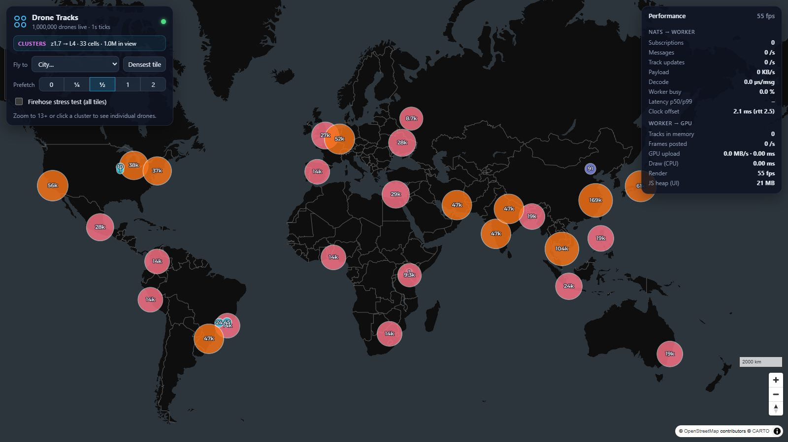
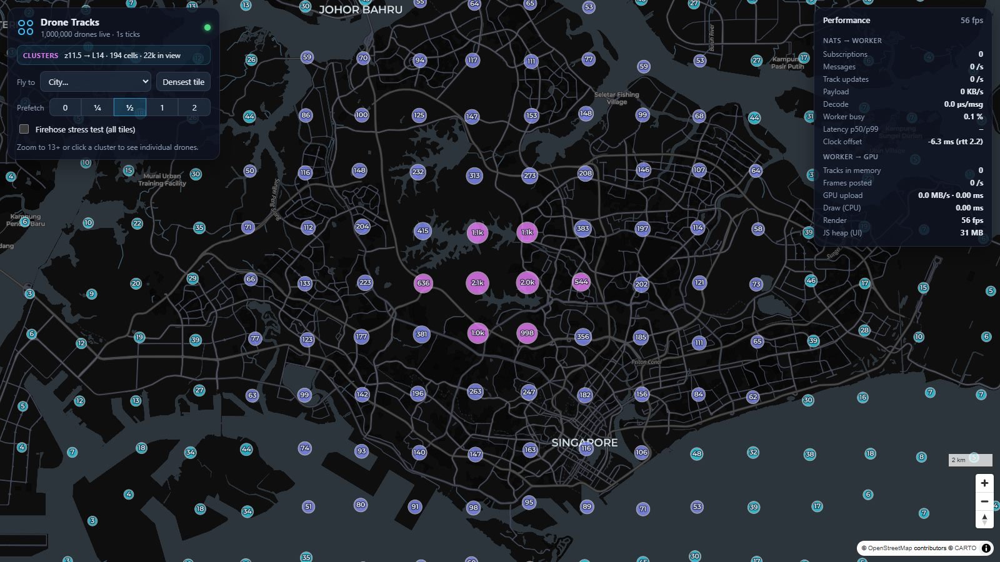
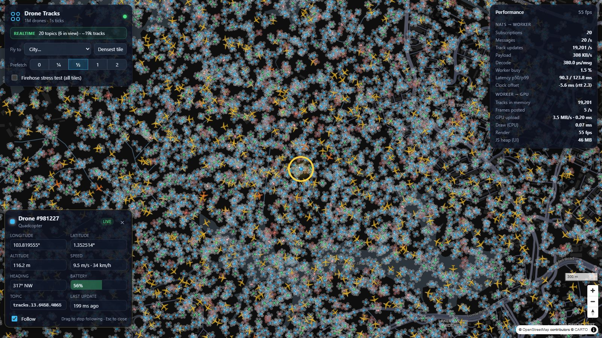
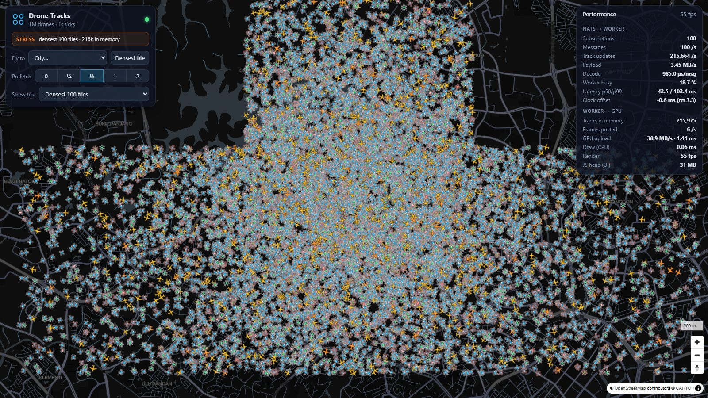
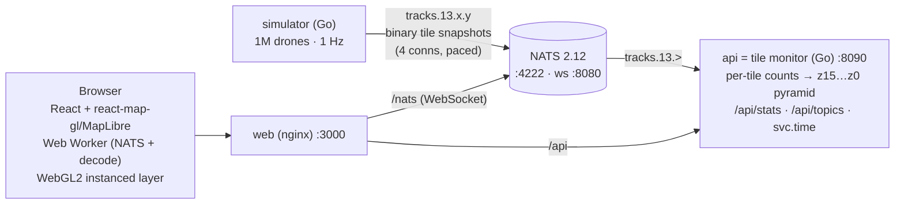

# Drone Tracks: 1 million realtime tracks on React + MapLibre

A demo of spatially partitioned realtime tracking. The Go backend and the React client agree on a
Web Mercator tile grid. Below zoom 13 the map shows clusters built from per-tile statistics. From
zoom 13 up, the client asks the backend which NATS subjects (one per z13 tile) cover the viewport
plus a prefetch ring, subscribes over NATS WebSocket, and draws every drone live. Click a drone to
open its info form, a pulsing ring and camera follow.

| | |
|---|---|
|  |  |
|  |  |

* **Implementation details** (how clusters are built and drawn, how the map handles many live tracks): [`docs/IMPLEMENTATION.md`](docs/IMPLEMENTATION.md)
* **Assessment of the approach** (advantages, drawbacks, mitigations): [`docs/ASSESSMENT.md`](docs/ASSESSMENT.md)
* **The tiling agreement, subjects, binary format and HTTP API**: [`docs/PROTOCOL.md`](docs/PROTOCOL.md)
* **Measured performance of the frontend listening to NATS**: [`docs/PERFORMANCE.md`](docs/PERFORMANCE.md)

## Architecture



| Zoom | Data path |
|---|---|
| `< 13` | `GET /api/stats?bbox&zoom` every tick returns cells at level `floor(zoom)+3` (64–128 px), each with a count and a **centroid**, drawn as MapLibre circle and label layers |
| `≥ 13` | `GET /api/topics?bbox&zoom&margin` returns `tracks.13.x.y` subjects for the viewport, the prefetch ring and at least one neighbour ring. A **Web Worker** diffs them against its current subscriptions (unsubscribe lingers 3 s), decodes the 16-byte records and ships a GPU instance buffer to the UI thread. A custom **WebGL2** layer draws heading-rotated drone icons and interpolates motion on the GPU, so 1 Hz data animates at 60 fps |
| selection | Picking runs in the worker. The info form updates at 4 Hz, a ring shader pulses around the drone, and the camera follows it (dragging stops follow; zoom pivots on the drone). In cluster mode the selected drone's tile and its neighbours stay subscribed, so it remains live |

## Run it

Needs Docker (Desktop) and about 1.5 GB of disk space for images.

```bash
docker compose up -d --build
# open http://localhost:3000
```

| Port | Service |
|---|---|
| 3000 | web: the app, plus `/api` and `/nats` proxied (single origin) |
| 8090 | api (tile monitor + HTTP API) |
| 8080 | NATS WebSocket |
| 4222 / 8222 | NATS client port / monitoring (`/varz`, `/connz`, `/subsz`) |

Try it: **Fly to → Singapore** (the densest tile) or **Densest tile**, zoom past 13, click a drone,
then zoom out while it is followed. The **Prefetch** buttons set the ring size, and **Stress test**
subscribes to the densest 100/400 tiles or the whole firehose. The **Performance** panel shows
msgs/s, tracks/s, decode cost, worker load, clock-corrected latency, fps and GPU uploads live.

URL parameters: `?lon=103.82&lat=1.35&zoom=14&margin=1&stress=100` (`stress=all` for the firehose).

Stop with `docker compose down`.

### Configuration (`docker-compose.yml`)

| Variable | Default | Meaning |
|---|---|---|
| `TRACKS` | 1000000 | simulated drones (`TRACKS=200000 docker compose up -d` for small machines) |
| `TICK_MS` | 1000 | publish interval |
| `PUBLISHERS` | 4 | parallel NATS connections of the simulator (tiles are sharded across them) |
| `PUBLISH_SPREAD_MS` / `PUBLISH_SLICES` | 60 % of tick / 20 | pace a tick's messages instead of one burst |
| `WORKERS` | CPUs / 2 | goroutines moving drones |
| `MAX_TOPICS` / `DEFAULT_MARGIN` | 256 / 0.5 | API cap on subjects per request / default prefetch margin |
| `PUBLIC_NATS_WS_URL` | (empty) | absolute WS URL for browsers; empty means same origin `/nats` |

NATS users (`nats/nats.conf`): `backend` has full access. `viewer` (the browser) may only subscribe to
`tracks.>` and `_INBOX.>` and publish to `svc.time`.

## Develop

```bash
# backend: tests and benchmarks (Go runs in Docker, so no local Go install is needed)
docker run --rm -v "$PWD/backend:/src" -w /src golang:1.26-alpine go test ./...
docker run --rm -v "$PWD/backend:/src" -w /src golang:1.26-alpine go test -run x -bench TickBreakdown ./internal/sim/

# frontend: run against the backend containers (the Vite proxy mirrors nginx)
cd frontend
npm ci
npm run dev          # http://localhost:5173
npm test             # decoder / track store unit tests (node --test)
npm run typecheck
npm run bench        # NATS WebSocket client benchmark (Node, same decoder as the worker)
npm run bench:browser -- perf --url http://localhost:3000   # the real app in Chrome
```

## Layout

```
backend/
  cmd/simulator          1M-drone flight model, radix-sorted by tile, parallel encode, paced publish
  cmd/api                tile monitor + HTTP API + svc.time responder
  internal/tiles         the tiling agreement (mercator, tile cover, subjects)
  internal/wire          binary tile snapshot codec
  internal/monitor       per-tile 4x4 sums -> count/centroid pyramid (lock-free reads)
  internal/sim           fleet (struct-of-arrays) and publisher
frontend/
  src/shared             tiles, wire decoder, TrackStore (SoA, swap-remove, GPU segments), metrics
  src/worker             tracks.worker.ts: NATS WebSocket, subscriptions, decode, frames
  src/map                TrackLayer (WebGL2 custom layer), drone icon atlas, tracking core + React provider/hooks,
                         map components (DroneLayer, ViewportSync, MapInteractions, ClusterLayers)
  src/components         toolbar, performance HUD, selected-track form
  bench                  ws-bench.ts (Node), browser-bench.ts (Playwright + Chrome)
nats/nats.conf           websocket, limits, users and permissions
docs/                    implementation, assessment, protocol, performance
```
