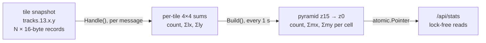
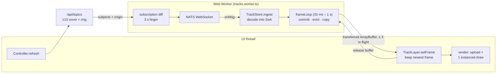
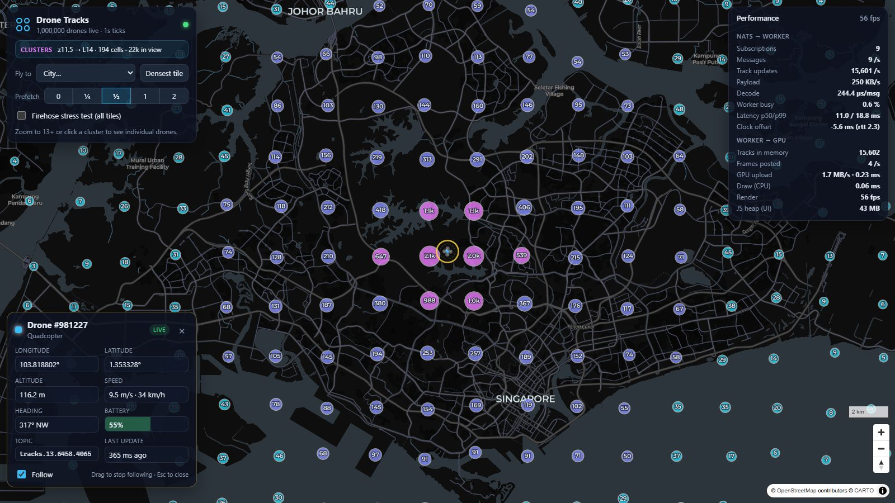

# Implementation details: how the map copes with 1 M tracks

The browser never holds the whole fleet. Three rules keep every stage bounded:

1. **The client only receives what the screen can show.** Below zoom 13 it gets a few hundred
   pre-aggregated clusters over HTTP. From zoom 13 up it subscribes only to the z13 tiles under the
   viewport plus a prefetch ring.
2. **Heavy work stays off the UI thread.** A Web Worker owns the NATS connection, decodes the binary
   snapshots and maintains the track table. The UI thread only uploads a ready-made buffer to the GPU.
3. **The GPU does the per-frame work.** Each drone is one instance of a single instanced draw call,
   and the vertex shader interpolates its motion. The CPU touches a track once per update (1 Hz), not
   once per frame (60 Hz).

The tiling scheme, subjects and binary format are specified in [`PROTOCOL.md`](PROTOCOL.md). This
document explains how the code uses them.

## 1. Two modes, one switch

| | Cluster mode | Realtime mode |
|---|---|---|
| Map zoom | `< 13` | `≥ 13` |
| Data | `GET /api/stats` every tick and after every move | NATS subscriptions to `tracks.13.x.y` |
| Volume on the wire | a few hundred cells as JSON | 20–40 k tracks/s, about 0.4 MB/s over a dense city |
| Drawn by | MapLibre `circle` + `symbol` layers on a GeoJSON source | custom WebGL2 layer (`TrackLayer`) |
| Code | `controller.ts` `loadClusters`, `App.tsx` layers | `tracks.worker.ts`, `trackStore.ts`, `TrackLayer.ts` |

`Controller.refresh()` (`frontend/src/map/controller.ts`) picks the mode from `map.getZoom()` on
every (debounced) camera change. A third mode, `stress`, ignores the viewport and subscribes the worker
to the N densest tiles or to `tracks.>`. It exists only for benchmarking.

The switch is not a hard cut. When the map crosses zoom 13 upward, the cluster layers stay visible
until the worker delivers its first non-empty frame, or for 2 s at most (`realtimeReady`), so the map
is never blank while the first snapshots are on their way. When it crosses back down, the track layer
switches to drawing only the selected drone and the worker's subscriptions are released after their
3 s linger.

## 2. How the clusters are built (backend)

Clustering happens on the server, once per tick for all clients. The client never runs a clustering
algorithm: it receives cells that are already aggregated and simply draws them. MapLibre's own GeoJSON
clustering (supercluster) is not used, because it would need every point in the browser.

The tile monitor (`backend/internal/monitor/monitor.go`) is the only consumer of the full firehose. It
subscribes to `tracks.13.>` with a 512 MB pending limit so it never becomes a slow consumer, and it
builds the cluster data in two steps.



### 2.1 Per-message: 4×4 sums per z13 tile (`Handle`)

Every z13 tile is split into 4×4 stats cells, which are exactly the z15 tiles inside it. For each
record the monitor takes the top 2 bits of the tile-local `lx` and `ly` (u16) as the sub-cell column
and row, and adds to that sub-cell:

* `count += 1`
* `sx += lx`, `sy += ly` (u64 sums of the raw u16 coordinates)

This loop is integer-only and runs before the lock is taken. The per-message sums are then merged into
the tile's state under a short lock. A tile larger than 65 000 tracks arrives in several parts with the
same `seq`, and the parts accumulate. A new `seq` resets the tile.

### 2.2 Every second: the pyramid (`Build`)

A ticker in `cmd/api` calls `Build()` once per second:

1. **Copy under the lock, aggregate outside it.** The per-tile sums (16 cells each) are copied into a
   reused scratch slice. Tiles not refreshed for 3 intervals are deleted, and tiles whose last
   snapshot was empty are removed after the copy. Message ingestion is blocked only for the copy
   (a few ms), never for the aggregation. Moving the aggregation out of the lock was part of the
   latency fix described in `PERFORMANCE.md` §4.
2. **z15 cells.** Each non-empty sub-cell becomes a z15 cell whose sums are converted to normalised
   mercator: `Σmx = (count·tx + sx/65536) / 2^13`, and the same for y.
3. **Roll up to z0.** Each level is built from the one below by adding every cell into its parent
   `(x>>1, y>>1)`. Count, `Σmx` and `Σmy` are all additive, so a parent is exactly the sum of its four
   children and no track is ever visited twice.
4. **Publish.** The finished `Snapshot` (16 level maps, plus the top 5 000 tiles for `/api/tiles/top`)
   is stored in an `atomic.Pointer`. HTTP handlers load the pointer and read an immutable structure
   with no lock at all.

The monitor stores sums, not means, because sums can be added up the pyramid. The **centroid** is
computed only when a cell is served: `Σmx / count`, `Σmy / count`, converted back to lon/lat. This puts
each cluster where the drones actually are, not at the centre of the cell, so a coastal city's cluster
sits on the city rather than in the sea.

### 2.3 Serving a viewport (`/api/stats`)

`GET /api/stats?bbox=w,s,e,n&zoom=z` picks the level `L = clamp(floor(z) + 3, 0, 15)`. A level-L cell
is `512 · 2^z / 2^L` px wide on screen, which with this formula is always between **64 and 128 px**.
Clusters therefore keep a constant on-screen density at every zoom, and a 1600×900 viewport can hold at
most about 400 cells whatever the fleet size. Example: at zoom 5.4 the level is 8, each cell is about
157 km wide and about 84 px on screen.

`Snapshot.CellsIn` chooses between two lookups:

* if the bbox covers at most 4× as many grid positions as the level has non-empty cells, it probes each
  `(x, y)` of the bbox in the level map;
* otherwise (low zoom, sparse level) it scans the level's cells and keeps those inside the bbox.

Both paths handle viewports that cross the antimeridian (MapLibre's world copies give `w < -180` or
`e > 180`) by wrapping tile x, and they never return a cell twice. The response JSON is written by
hand with `strconv.Append*` into one buffer, because this is the endpoint every cluster-mode client
calls once per second.

## 3. How the clusters are drawn (frontend)


### 3.1 Fetching

* **On camera changes.** `move` and `moveend` call `scheduleRefresh`: a 150 ms trailing debounce with
  a 600 ms maximum wait, so a long continuous pan still refreshes at least every 600 ms.
* **Every tick.** `pollStats` reloads the clusters every `publishIntervalMs` (1 s) while in cluster mode
  and while the tab is visible, so the counts move with the fleet even when the camera is still.
* **No stale responses.** Every refresh aborts the previous request (`AbortController`) and tags the
  new one with a sequence number. A response that arrives after a newer request, or after the map has
  left cluster mode, is ignored.

### 3.2 From cells to GeoJSON

`loadClusters` turns each `[x, y, count, lon, lat]` cell into a GeoJSON point at the centroid, with
`id = x·65536 + y`, `count`, and a short `label` (`compact()`: `812`, `4.6k`, `23k`, `1.0M`). The whole
`FeatureCollection` is put into React state, and react-map-gl calls `setData` on the `clusters` source.
A few hundred points per second is a trivial load for MapLibre's GeoJSON worker.

### 3.3 Styling (`App.tsx`)

Two layers share the `clusters` source. The circle layer:

| Property | Expression | Result |
|---|---|---|
| `circle-radius` | linear interpolation on `sqrt(count)` | √1 → 7 px, √10 → 11 px, √30 → 16 px, √100 → 24 px, √300 → 34 px |
| `circle-color` | `step` on `count` | < 50 cyan, 50–499 indigo, 500–4 999 fuchsia, 5 000–29 999 rose, ≥ 30 000 orange |
| `circle-opacity` / stroke | constants | 0.82, 1.5 px white at 55 % |

The radius follows the square root of the count, so a circle's **area** grows roughly with the number
of drones and a 90 000-drone cluster does not cover the screen. Colour gives a second, coarser
order-of-magnitude cue.

The symbol layer prints `label` in white with a dark halo. `text-allow-overlap` and
`text-ignore-placement` force every label to show, because the cells are already spaced 64–128 px
apart. The font stack is the one the CARTO dark-matter style uses, so its glyph server can serve it.

Both layers are hidden (`visibility: none`) in realtime mode once the first live frame has arrived.

### 3.4 Interaction

Clicking a cluster runs `easeTo` on its centroid. From zoom 10 up the click zooms straight to 13.5,
into realtime mode. Below zoom 10 it zooms in by 2.5 levels, which splits the cluster into up to
16–64 child cells.

## 4. How the realtime view handles many tracks



### 4.1 Subscribe only to what is on screen

`GET /api/topics` (`tiles.CoverTopics`) returns the z13 tiles under the viewport, grown by `margin` ×
the viewport size on each side, plus at least one ring of neighbours. Viewport tiles come first,
sorted from the centre outward, then prefetch tiles. The list is capped at `MAX_TOPICS` (256), so when
it is truncated the farthest prefetch tiles go first. A z13 tile is about 4.9 km wide and 512 px on
screen at zoom 13, so a 1600×900 viewport there touches up to 15 tiles. The response also carries `expectedTracks`, which the HUD shows.

The worker (`applyTopics`) diffs the new list against its live subscriptions:

* new subjects are subscribed immediately;
* subjects no longer wanted are kept for another **3 s** (`LINGER_S`), so panning back and forth does
  not churn SUB/UNSUB and does not wait for a fresh snapshot;
* when a linger expires, the worker unsubscribes and marks every track of that tile as stale, and the
  next eviction pass removes them.

### 4.2 The track table (`TrackStore`)

`frontend/src/shared/trackStore.ts` is a struct-of-arrays table: one typed array per field (`Float64Array`
for positions and times, `Float32Array` for heading, altitude and speed, `Uint8Array` for type, battery
and flags), indexed by **slot**. A `Map<id, slot>` finds a track's slot.

* **Ingest** decodes a snapshot with one `DataView` straight from the NATS payload. It allocates nothing
  per track: an unknown id takes the next slot, and the newest position, heading, altitude and so on go
  into the "pending" fields. The slot is pushed onto a dirty list once per commit cycle.
* **Removal is swap-with-last.** Slots `0 … n-1` are always dense, so the GPU buffer is the first
  `n × 9` floats of `inst` and is drawn with a single call.
* **Growth** doubles every array when a snapshot would not fit.
* **Tile edges** need no special handling. State is keyed by track id, not by tile, so a drone that
  crosses into the next tile simply shows up in that tile's next snapshot. A track not seen for
  1.5 × the interval is evicted.

### 4.3 Interpolation segments

At 1 Hz, drawing reported positions directly would make every drone jump once per second. Instead,
`commit()` gives each updated track a segment:

```
start = the position the track is displayed at right now (interpolated)
end   = its newest reported position
t0    = now          (shared clock, seconds)
```

The GPU moves the drone from `start` to `end` over `interp = 1.15 × interval`. Because the segment
starts at the *displayed* position and not at the previously reported one, an update that arrives early
or late changes the drone's course smoothly instead of making it jump. The 15 % margin keeps a drone
moving until its next update, at the cost of drawing it about one interval behind the truth. Heading is
interpolated the same way, along the shorter arc. A brand-new track starts with `start = end`.

### 4.4 Shipping frames to the GPU

Each track has a 9-float (36 B) instance record:

| Floats | Content |
|---|---|
| 0–1 | segment start, mercator, relative to the origin |
| 2–3 | segment end, relative to the origin |
| 4 | `t0` |
| 5–6 | start heading, end heading (radians) |
| 7 | altitude (m) |
| 8 | type + 4 if battery < 20 % |

`frameLoop` in the worker runs on a self-adjusting timer. It commits pending updates, evicts stale
tracks (every 0.25 s) and, only if something changed, copies the `n × 9` floats into a pooled
`ArrayBuffer` and **transfers** it to the UI thread, without a structured-clone copy. Two limits keep
large stores from flooding the UI thread:

* **Upload budget.** The next frame is scheduled after `clamp(n × 36 B / 50 MB/s, 33 ms, 1 s)`. 20 k
  tracks refresh at 30 Hz, 470 k tracks at about 3 Hz. Animation stays at display rate either way,
  because motion comes from the shader, not from new frames.
* **Back-pressure.** At most 3 buffers are in flight. When the UI thread is behind, the worker skips the
  frame and tries again on the next tick.

On the UI thread `TrackLayer.setFrame` keeps only the newest frame and immediately returns any older,
not-yet-uploaded one to the worker's pool. During the next MapLibre render, `upload()` orphans the GPU
buffer (`bufferData` with the current capacity, grown 1.25× when needed) and writes the frame with
`bufferSubData`, so it never overwrites storage the GPU may still be reading.

### 4.5 Drawing: one instanced draw call

`TrackLayer` is a MapLibre `CustomLayerInterface` that renders in MapLibre's own WebGL2 context. All
drones are drawn by one `drawArraysInstanced(TRIANGLE_STRIP, 0, 4, n)`: a 4-vertex quad, instanced
`n` times.

The vertex shader, for each drone and each frame:

1. computes `f = clamp((u_now - t0) / u_interp, 0, 1)` and the position `mix(start, end, f)`;
2. interpolates the heading along the shorter arc and subtracts the map bearing, so icons stay correct
   when the map is rotated;
3. projects the centre with MapLibre's matrix, then offsets the quad corners in **screen space**. Icons
   are a fixed pixel size, `clamp(18 + (zoom − 13) × 5.5, 16, 46)` CSS px, scaled 0.85–1.15× by
   altitude, whatever the zoom or pitch.

The fragment shader samples a 4-cell icon atlas (quadcopter, hexacopter, fixed-wing, emergency), which
`droneAtlas.ts` draws on a canvas at startup, so the app ships no image files. The atlas is
premultiplied and mipmapped, and blending uses `ONE, ONE_MINUS_SRC_ALPHA`. Drones under 20 % battery
blink red, driven by `u_now` in the shader.

After drawing, the layer calls `map.triggerRepaint()`: positions are a function of time, so the map keeps
rendering while there is something to animate. The per-frame CPU cost is a handful of uniforms,
regardless of `n`.

### 4.6 Precision

Two things would break float32 on the GPU at street level:

* **Absolute mercator coordinates.** A value near 0.8 has a float32 step of about 6·10⁻⁸, which is
  several pixels at zoom 18. The worker therefore stores instance positions **relative to an origin**
  (the viewport centre at the last topic refresh; `setOrigin` re-bases all instances when it moves).
  `translated()` folds the origin into MapLibre's matrix in float64 on the CPU before handing the
  matrix to the GPU as float32.
* **Large timestamps.** The UI thread, the worker and the shader share one clock: seconds since an
  epoch taken when the page starts (`shared/clock.ts`, built on `performance.timeOrigin +
  performance.now()`, which agrees across a page and its workers). `t0` and `u_now` stay small numbers
  with plenty of float32 precision.

## 5. Selection, picking and follow


* **Picking** runs in the worker, which owns the positions. A click is converted to mercator and the
  worker scans every track's *displayed* (interpolated) position for the nearest one within 16 px
  (`16 / (512 · 2^zoom)` mercator units).
* **Rendering.** Each frame carries a copy of the selected drone's 9 floats. The layer dims the other
  drones to 75 % opacity, draws a pulsing ring (`FS_RING`, 3× the icon size) and redraws the selected
  icon at 1.35× on top.
* **Info panel.** The UI's `requestAnimationFrame` loop pushes the selected track's info to React at
  4 Hz.
* **Camera follow.** The same loop interpolates the selected instance exactly like the shader does and
  calls `jumpTo` on that point unless the map is moving, so the drone stays centred without fighting a
  gesture. Dragging stops follow. While following, wheel and pinch zoom pivot on the screen centre,
  that is, on the drone.
* **Selection in cluster mode.** Zooming below 13 would normally drop every subscription. Instead,
  `keepSelectionSubscribed` asks `/api/topics` for a tiny bbox around the drone (its tile plus the
  mandatory neighbour ring), so it stays live and can be followed while zoomed out to the cluster
  view. The track layer then draws only the selected drone.



## 6. The producer side

The simulator (`backend/internal/sim`) has to produce 1 M tracks per second and must not become the
bottleneck itself:

* **Struct-of-arrays fleet**, stepped in parallel. During the step each goroutine also writes the
  drone's 16-byte wire record and a sort key `tileKey << 32 | index`.
* **Radix sort by tile.** Two 13-bit LSD passes over the 26-bit tile key group all drones by tile in
  O(n). This step takes about 9 ms for 1 M drones.
* **Parallel gather.** Each tile becomes one message, split into parts at 65 000 records to stay under
  NATS's 1 MB `max_payload`. Records are copied into one contiguous tick buffer by several goroutines.
  A tile that has just become empty gets one empty snapshot so subscribers and the monitor can clear
  it.
* **Sharded, paced publishing.** Tiles are spread over 4 NATS connections by `key % 4` (a tile always
  uses the same connection, which keeps per-subject ordering) and sent in 20 slices over 60 % of the
  tick instead of one 17 MB burst. Each header's `publishedAt` is stamped right before sending, so the
  latency figures are honest.

## 7. What bounds each stage

| Stage | Bounded by | Typical size |
|---|---|---|
| Cluster response | screen area: cells are 64–128 px | ≤ ~400 cells for 1600×900 |
| Pyramid build | non-empty z13 tiles × 16 sub-cells, rolled up once per second | about 100–150 ms per second, off the ingest lock |
| Realtime subscriptions | viewport + prefetch ring, capped at 256 | 20–170 tiles |
| Tracks in the worker | tracks inside the subscribed tiles | 20–40 k over a dense city |
| Worker CPU | about 0.3–1 µs per track update | about 1 % of a core |
| UI → GPU traffic | 36 B × tracks × frame rate, capped at about 50 MB/s | about 0.3 ms upload per frame |
| GPU per frame | one instanced draw, interpolation in the shader | 1 draw call |

Measured numbers for each row are in [`PERFORMANCE.md`](PERFORMANCE.md). The known limits of the
approach (density skew, first-snapshot wait, fan-out egress) and their mitigations are in
[`ASSESSMENT.md`](ASSESSMENT.md).
